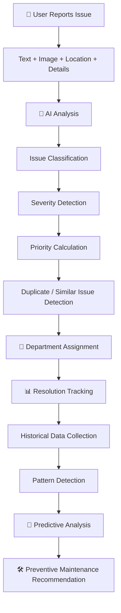
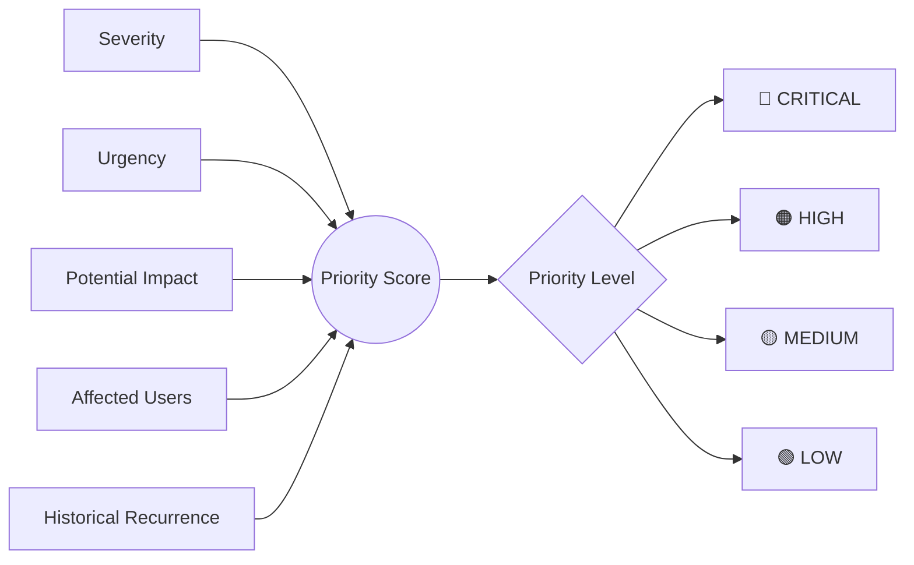
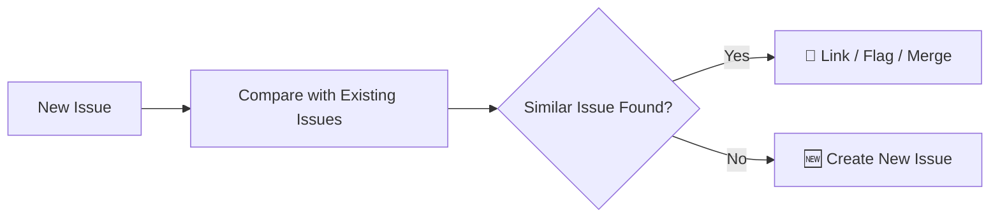
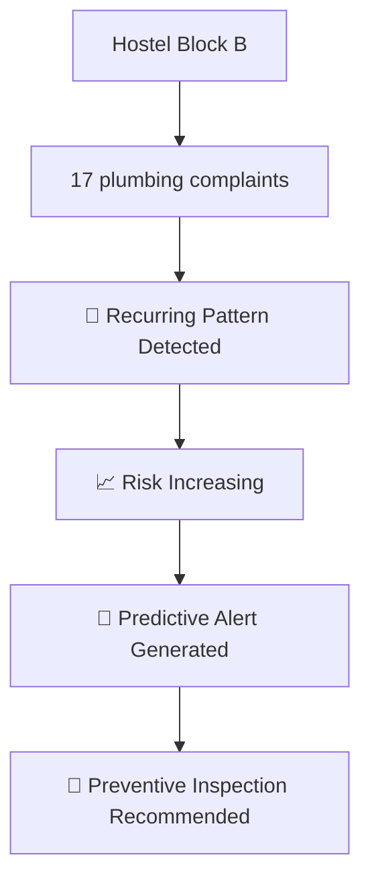
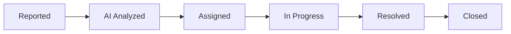

<div align="center">

# 🏫 ResolveX

### Intelligent & Predictive Campus Issue Reporting & Prioritization Platform


<br/>

[](#)
[](#)
[](#)
[](#)
[](#)
[](#)

<br/>


</div>

---

## 🧠 What is ResolveX?

> ResolveX transforms the traditional, manual campus complaint system into an **intelligent, predictive, and data-driven platform**.

Instead of treating every campus complaint the same, ResolveX **understands** the issue, **analyzes** its severity, assigns an **AI-driven priority score**, **routes** it automatically to the right department, **tracks** its resolution — and **learns** from historical data to **predict** and **prevent** future problems.

<div align="center">

```
UNDERSTAND → PRIORITIZE → ROUTE → RESOLVE → LEARN → PREDICT → PREVENT
```

</div>

---

## 😩 The Problem

Traditional campus complaint systems are purely **reactive**:

| Pain Point | Impact |
|---|---|
| 🔴 Critical issues buried under routine ones | Safety risks go unnoticed |
| 🐌 Manual classification & routing | Slow response times |
| 📋 Duplicate complaints | Wasted staff effort |
| 🕳️ No centralized visibility | Poor decision-making |
| 🔁 Recurring problems go unnoticed | Same issues repeat endlessly |
| 📉 Historical data underutilized | Zero predictive power |
| 🧯 Maintenance is reactive, not preventive | Higher long-term cost |

**ResolveX fixes this with AI-driven prioritization, automated routing, analytics, and predictive intelligence.**

---

## ⚙️ How It Works



---

## ✨ Key Features

<table>
<tr>
<td width="50%" valign="top">

### 👤 For Students
- 🔐 Simple account creation & login
- 📍 Report issues with text, image & location
- 🤖 Instant AI analysis of the issue
- 📈 See real-time priority & severity
- 🔔 Live status tracking & notifications
- 🕓 View full report history

</td>
<td width="50%" valign="top">

### 🛡️ For Admins
- 📊 Centralized Campus Operations Dashboard
- 🚨 Intelligent Priority Queue
- 🗺️ Live Campus Issue Map
- 🧩 Duplicate/similar issue merging
- 📉 Analytics & department workload
- 🔮 Predictive alerts & AI insights

</td>
</tr>
</table>

---

## 🤖 AI Analysis — Example

**Input:**
> "Water leakage near electrical equipment in Engineering Block."

**AI Output:**

| Field | Value |
|---|---|
| 🏷️ Category | Electrical + Water Infrastructure |
| 🔥 Severity | **CRITICAL** |
| 🎯 Priority | **92 / 100** |
| ✅ Confidence | 96% |
| 🏢 Department | Electrical Maintenance |
| 💬 Reason | *"Water is present near electrical infrastructure, creating a potential safety hazard."* |

---

## 🧮 Intelligent Priority Engine

ResolveX never prioritizes by submission order. Priority is computed from multiple real-world signals:



<div align="center">

| Issue Example | Priority Level |
|---|:---:|
| Broken classroom chair | 🟢 LOW |
| Wi-Fi issue affecting 1 student | 🟢 LOW / 🟡 MEDIUM |
| Internet outage — entire building | 🟠 HIGH |
| Water leakage near electrical equipment | 🔴 CRITICAL |

</div>

---

## 🗂️ Smart Department Routing

| Issue Type | Auto-Routed To |
|---|---|
| ⚡ Electrical | Electrical Maintenance |
| 🚰 Water / Plumbing | Plumbing |
| 📶 Internet / Wi-Fi | IT Department |
| 🗑️ Garbage | Sanitation |
| 🏗️ Building / Road Damage | Civil Maintenance |
| ❄️ AC / Fan / HVAC | HVAC Department |
| 🚨 Security | Security Department |

---

## 🧩 Duplicate Issue Detection



---

## 🔮 Predictive Intelligence

The real differentiator — ResolveX doesn't just ask *"what's broken?"*, it asks ***"what's about to break?"***



**Example AI Insights shown on the Admin Dashboard:**

> 💡 "Electrical issues increased this week."
> 💡 "3 high-priority issues require immediate attention."
> 💡 "Hostel Block B shows a recurring plumbing pattern."
> 💡 "Preventive inspection may be required in frequently affected areas."

---

## 📊 Issue Lifecycle



---

## 🖥️ Tech Stack

<div align="center">

| Layer | Technologies |
|---|---|
| **Frontend** |    |
| **Backend** |   |
| **Database** |  |
| **AI / ML** | Machine Learning • NLP • Computer Vision • Predictive Analytics • Pattern Detection |
| **Tooling** |    |

</div>

---

## 📁 Project Structure

```
ResolveX/
├── frontend/
│   ├── public/
│   └── src/
│       ├── components/
│       ├── pages/
│       ├── layouts/
│       ├── services/
│       ├── hooks/
│       ├── utils/
│       └── types/
│
├── backend/
│   └── app/
│       ├── api/
│       ├── models/
│       ├── schemas/
│       ├── services/
│       ├── core/
│       └── main.py
│
├── ml/
│   ├── models/
│   ├── preprocessing/
│   ├── training/
│   └── inference/
│
├── README.md
└── .gitignore
```

---

## 🗺️ Development Roadmap

- [x] **Phase 1 — Frontend** — UI built with mock data (landing, dashboards, report flow, admin panel, priority queue, campus map)
- [ ] **Phase 2 — Backend** — Auth, issue APIs, priority engine, analytics APIs
- [ ] **Phase 3 — Database** — PostgreSQL schema & relationships
- [ ] **Phase 4 — AI / ML** — Classification, severity & priority prediction, duplicate & image analysis, pattern detection
- [ ] **Phase 5 — Integration** — Connect Frontend ↔ Backend ↔ DB ↔ AI/ML
- [ ] **Phase 6 — Deployment** — Ship it 🚀

<div align="center">


</div>

---

## 🎨 Design Philosophy

ResolveX is built to feel like a **modern AI SaaS platform** — not a generic college complaint portal.

✅ Clean • Modern • Data-driven • Premium • Minimal • Strong visual hierarchy
🚫 No excessive gradients, cartoonish UI, or Bootstrap-default dashboards

**Color System**

| Priority | Color | Status | Color |
|---|---|---|---|
| Critical | 🔴 Red | Reported | 🟣 Purple |
| High | 🟠 Orange | AI Analyzed | 🔵 Blue |
| Medium | 🟡 Yellow | In Progress | 🟡 Yellow |
| Low | 🟢 Green | Resolved | 🟢 Green |

---

## 🚀 Getting Started

```bash
# Clone the repository
git clone https://github.com/<your-username>/ResolveX.git
cd ResolveX

# Frontend setup
cd frontend
npm install
npm run dev

# Backend setup (coming soon)
cd backend
pip install -r requirements.txt
uvicorn app.main:app --reload
```

---

## 🤝 Contributing

Contributions, issues, and feature requests are welcome!
Feel free to check the [issues page](../../issues) or open a PR.

---

<div align="center">

### 💡 The Vision

**Reactive → Predictive** &nbsp;|&nbsp; **Manual → Intelligent** &nbsp;|&nbsp; **Complaint-driven → Data-driven**

*ResolveX doesn't just collect campus complaints — it understands, prioritizes, learns, and predicts.*

<br/>

⭐ **If you like this project, consider giving it a star!** ⭐


</div>
